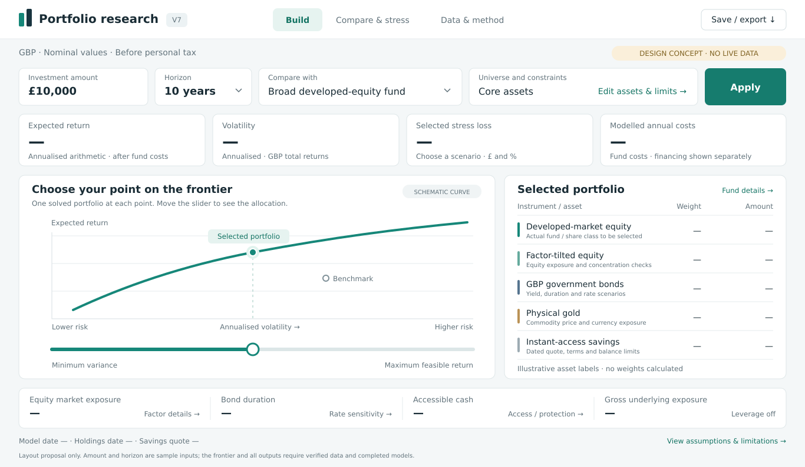

# V7 build plan

Status: planning handover, 12 October 2026. V7 is not implemented by this document.

Baseline: V6 package `0.1.2`, repository commit `2403dbf9f85aeec3b9ba99d7a0212e24ab3169b4`. The Python 3.14.8 deployment dependencies and both installation checks passed, with 23 tests. That establishes software behaviour; it does not validate the legacy investment results.

## 1. The build decision

Keep the private Python + Streamlit app. Replace the legacy demonstration as the normal entry point with a small, dated, verified research dataset. Use FF5 for developed-equity funds and appropriate models for the other assets. Keep the existing constrained quadratic-programming frontier and make its selected portfolio the centre of the interface.

The first release should answer five questions together:

1. What portfolio does this point on the frontier contain, in percentages and pounds?
2. What return assumptions produce that result, and how sensitive is it to those assumptions?
3. What risks am I taking: volatility, drawdown, concentration, rates, currency and leverage?
4. How does it compare with a broad-market fund and cash on consistent assumptions?
5. Which observations are actual fund data, which are proxies, and which are forecasts?

Start with roughly 12–20 instruments, with a normal interface limit of 30. Begin development with five representative cases: one developed-equity fund, one GBP government-bond ETF, one physical-gold ETC, one actual instant-access savings quote and one daily 2× broad-equity product. These are data/model test cases, not a recommended allocation. Choose exact share classes after checking identifiers, source coverage and availability through the user's broker.

The full build includes an advanced leveraged-product view. Admission of a leveraged product to the optimiser is a separate validation gate; listing it in the app must not imply that its model is ready.

### What to retain and replace

| Retain | Change for V7 |
| --- | --- |
| CVXPY solver, numerical constraint checks and frontier slider | Apply an asset-aware data contract and constraints |
| Chronological ridge validation and explicit GBP conversions | Calibrate on documented actual fund total returns |
| Covariance shrinkage, duplicate-series handling, fee discipline | Use a coherent cross-asset covariance as the default |
| Data fingerprints, run IDs and Excel/diagnostic exports | Include source vintages, asset models and scenario assumptions |
| Original V5 files, unchanged in `data/legacy` | Remove them from the normal research workflow; retain as an archive |
| Identifiers and source leads from V5 | Recheck identities and current facts before accepting them |

Do not reuse the legacy return rows as verified history, stale holdings as current exposures, or legacy factor priors as fitted betas. `fundamentals.csv` is empty. The interview values of 8% return, 18.4% volatility and beta 1.10 remain unverified; do not design the new model to reproduce them.

## 2. Data to obtain

### Source plan

| Input | Preferred source and treatment | History / refresh requirement |
| --- | --- | --- |
| Instrument identity | Issuer product page, factsheet and prospectus: ISIN, exchange, share class, trading unit, benchmark, inception, legal structure and hedge policy | Verify once, then on changes |
| Equity, bond and commodity product returns | Actual issuer NAV total-return series where available. Otherwise one end-of-day provider, with corporate actions and issuer reconciliation | Daily history where available; 120 complete months preferred, 72 minimum for the initial equity/core research universe |
| FF5 and original risk-free series | Kenneth French Data Library; use the developed-market monthly five factors for the initial common equity basis [S1] | Full compatible history for premium scenarios; refresh monthly and freeze each downloaded vintage |
| GBP cash reference | Bank of England SONIA; compound the applicable daily rates or use the compounded index. This is a cash benchmark, not an available retail account [S2] | SONIA history starts in 1997; compounded-index history starts on 23 April 2018, with publication launched in 2020. Do not extrapolate earlier values silently |
| FX | Bank of England daily exchange rates where covered; documented provider fallback for missing currencies | Match the return dates and quote convention; retain source and timing |
| Bond characteristics | Issuer dated factsheets/holdings: yield definition, effective duration, spread duration where relevant, convexity, currency, credit quality, costs. BoE curves for UK rate scenarios [S6, S7] | Latest monthly snapshot; retain historical snapshots prospectively |
| Current holdings | Issuer holdings downloads and reviewed issuer/country/sector mapping | Monthly where available; display coverage and date |
| Savings | Actual provider quote and product terms, supplied or identified by the user; verify bank licence grouping against FSCS [S8] | Dated quote, bonus end, eligibility, access rules, limits and maturity; reconfirm after expiry/change |
| Leveraged products | Actual daily NAV/returns plus the issuer's benchmark, reset, financing, fee, collateral and termination documentation | Daily data, product-specific terms; underlying and funding history must be aligned |
| Non-GBP funding | The rate required by the chosen product, e.g. official USD overnight funding data for a USD-financed product | Do not substitute GBP SONIA for every product's financing rate |
| Inflation, optional | ONS CPI observations plus a separately stated future inflation assumption | Only needed for real-value comparisons |

**Bulk-price provider candidate: EODHD, subject to the five-instrument pilot.** Its documented API covers daily prices and adjusted closes, but its free plan's one-year history is insufficient for this calibration. Exchange coverage, full-history entitlement, adjustment conventions and permission to use/store the data in a private hosted app must be checked before selection [S3, S4]. Its own caveats mean that vendor values require reconciliation, not automatic acceptance.

No subscription has been purchased, API connection verified, or complete V7 dataset downloaded during this planning task. A provider's advertised coverage does not establish that a particular share class has a usable history.

If paid data is unwanted, use a smaller universe with verifiable issuer exports and public French/BoE inputs. That can still produce a useful tool. Complete coverage, reliable automatic updates and zero data cost cannot all be promised. Avoid building the core around undocumented scraping or an unofficial endpoint that has no stable contract.

### Data rules that must be implemented

- Identify an instrument by share class/ISIN and exchange, not ticker alone. Separate trading currency, fund base currency and economic currency exposure. GBP listings do not automatically remove foreign-currency risk.
- Use total returns with distributions reinvested. Raw NAV for a distributing fund is insufficient. Vendor adjusted closes need a documented split/dividend convention and a reconciliation around at least one distribution and corporate action where applicable.
- Normalise pence versus pounds before calculating returns. Convert local total-return indices into GBP using a consistent FX quote and timestamp. Do not convert a series already supplied in GBP a second time.
- Use monthly simple decimal returns in calibration and optimisation. Retain daily data for leveraged products, drawdowns and historical stress. Prefer consistent month-end valuation times; disclose remaining market-close mismatches.
- Distinguish genuine non-trading days from missing observations. Use documented exchange calendars; reject unresolved gaps. Do not insert zero returns or interpolate prices to conceal missing data. Daily leveraged paths need a consistent benchmark/reset calendar.
- No undocumented pre-inception splices. A licensed, published index proxy is a separate series with its own label and measured tracking error over the overlap. Current holdings cannot reconstruct a fund's historical holdings without look-ahead bias.
- Preserve source files, retrieval times, content hashes, corrections and licence/use notes. Published historical series can be revised. A present-day backtest cannot be called a true point-in-time test unless the historical vintages were available at each decision date.
- Separate technical validity, source reconciliation and model suitability. Each instrument gets a status of `eligible`, `comparison only`, or `blocked`, with specific reasons. A valid CSV is not a financial quality stamp.

Initial freshness policy: show every source date; block new research runs if the common return month is more than 90 days old. Require bond characteristics and holdings used in active constraints to be no more than 90 days old. Reverify savings quotes after 30 days or their stated validity/bonus expiry, whichever occurs first. These are explicit operational thresholds, not guarantees that information stays unchanged between checks. Saved dated results remain viewable. A failed refresh must not reset an observation's age.

### Proposed contract

Use small CSV/JSON metadata files and compressed Parquet for time series. Replace the equity-only five-file upload contract with a versioned, asset-aware snapshot. The normal user opens the approved snapshot; uploading files is an advanced recovery/development function.

| File | Essential contents |
| --- | --- |
| `instruments.csv` | Stable ID, ISIN, exchange, asset/model type, structure, currencies, price unit, inception, benchmark, hedge status, fee definition, leverage and eligibility |
| `total_returns_daily.parquet` | Instrument, valuation date, actual/proxy flag, local and GBP total-return indices, source ID; retain raw price/distribution evidence separately |
| `factors_monthly.csv` | Date, factor basis, factor, decimal return and source currency; exclude annual summary/footer rows |
| `cash_fx_daily.parquet` | Date, cash/funding rate or index, FX pair, quote convention, day-count and source |
| `curves.csv` | As-of date, currency, tenor, yield and compounding convention |
| `fund_characteristics.csv` | Dated TER/costs, yield type, duration, convexity, spread/credit fields and evidence links |
| `holdings_snapshot.parquet` | Fund, as-of date, security/issuer ID, signed weight, economic asset exposure, country/sector, unknown/unmapped flags |
| `savings_quotes.csv` | Provider/product, quote validity, AER/gross rate, compounding, balance bounds, bonus/maturity/access terms, bank licence group |
| `leverage_terms.json` | Benchmark return definition and currency, multiplier, reset calendar, financing, fees, intraday resets/barriers and termination rules |
| `assumptions.json` | Forward premiums, cash/rate/inflation scenarios, expected losses, cost assumptions, constraints, rebalancing policy and simulation seed |
| `manifest.json` | Schema/model versions, hashes, sources, retrieval/as-of dates, licences, sample windows and reconciliation results |

Fields are mandatory by model type. Missing convexity may permit a labelled linear bond stress; missing leverage reset/termination terms blocks the leveraged model. Do not fill economically important unknowns with zero.

## 3. Equity: a sensible FF5 calibration

The initial model is **return-based exposure estimation**, not a regression from current company fundamentals. This is a defensible change in methodology and a much smaller data requirement.

Use one developed-market FF5 basis for the initial developed-equity universe so that portfolio exposures can be combined meaningfully. US/regional fits can be diagnostics. Emerging-market or hedged-equity funds require a separately documented basis and validation before admission. Betas from different factor bases cannot simply be added into one chart.

Let `x` be the return of USD measured in GBP. Retain the V6 currency convention:

```text
GBP market excess = (1 + USD market excess + USD cash) × (1 + x) − 1 − GBP cash
GBP style spread  = USD style spread × (1 + x)
fund net excess   = intercept + beta × GBP factors + residual
```

Style factors are zero-investment spreads; adding a standalone FX return would be incorrect. Record that compounded SONIA is the selected GBP cash proxy, with a different instrument convention from French's original USD cash series.

Use up to the latest 120 complete months, with 72 as a practical minimum. Keep V6's chronological ridge selection: penalties `0, 0.1, 1, 10, 100`; unpenalised intercept; standardisation fitted inside each training fold; expanding folds with 12-month validation blocks and at least 36 initial months, capped at five folds. Reserve the final 12 months for assessment after specification selection, then refit the chosen specification for current exposures.

Where history permits, add rolling-window beta stability and earlier walk-forward comparisons. Compare ridge with market-only OLS and unregularised FF5. Report out-of-sample error and instability. If FF5 persistently adds no useful explanatory evidence, allow an explicitly labelled market-only model; do not force five-factor coefficients merely to retain the project's name. Do not present a 12-month holdout or good fit as proof that future factor premiums are predictable.

### Forward return policy

```text
expected monthly net return = assumed GBP cash
                            + beta × assumed GBP factor premiums
                            − incremental fund costs
```

Use zero expected gross alpha. Historical net alpha remains a diagnostic. The initial fee approximation can remain TER/12, with its limitation stated; an all-in tracking-cost estimate must replace, rather than duplicate, the expenses it contains. Historical actual-fund net returns already include fund-level costs and must not have TER deducted again.

Premiums are forward assumptions informed by history, not automatically the mean return of each ETF. Use the longest mutually compatible factor/cash/FX history for scenario suggestions, separate from the shorter exposure-estimation window.

Recommended research preset: 100% of the long-history market premium and 50% of each long-history style premium. Halving styles is an explicit uncertainty haircut, not an empirically optimal estimator. Preserve signs; do not clip unfavourable means to zero. Always compare full, half and zero style premiums, and market-premium shifts of ±2 percentage points per year. Users can override the assumptions. The preset must be labelled as a modelling policy rather than a best forecast.

Use the latest completed month's annualised compounded SONIA as an initial short-rate assumption, clearly dated. It is not a market-implied forward curve or a guaranteed savings rate. Longer-horizon rate scenarios must be explicit.

## 4. Asset-specific extensions

### Bonds

Start with GBP government-bond ETFs. Historical actual-fund total returns provide covariance and realised drawdowns. A forward carry-based estimate uses current yield with its stated compounding convention, less incremental costs and expected credit losses where relevant.

```text
monthly expected return ≈ carry + modelled roll-down
                          − duration × expected yield change
                          − expected credit loss − incremental costs
rate stress return     ≈ carry − duration × yield shock
                          + 0.5 × convexity × yield shock² − costs
```

The initial central case assumes unchanged yields and no separately estimated roll-down. Show this approximation; do not add roll-down without curve/holdings support. Stress curve shifts and steepening separately when the required duration buckets exist. Credit spread duration and expected losses must be distinguished from government-rate exposure.

Coupon and trailing distribution yield are not expected total return. Yield to maturity is not a guaranteed bond-ETF holding-period return, and a constant-maturity ETF does not mature like a deposit. Issuer factsheets demonstrate that dated yield/duration inputs exist, but each selected product must be checked [S6].

Add investment-grade credit after documenting spread/default assumptions. High-yield credit needs an explicit loss scenario and remains conditional on that gate. GBP-hedged foreign bond funds require actual share-class returns and a consistent hedge-cost forecast. Do not double count FX hedging.

Current duration/yield data can support today's forecast and stresses. A historical validation of that forecast requires historical characteristic vintages; current characteristics must not be retroactively applied as if known then.

### Physical gold and commodity futures

Treat physical-gold ETCs separately from futures-based commodity funds. Confirm the actual legal structure: ETF, ETC and ETN are not interchangeable.

- Physical gold: price and FX movements, less product costs; no FF5 or coupon income assumption.
- Futures-based products: the benchmark's roll, collateral and price-return conventions matter. A total-return index or actual fund total-return history may already include collateral return and rolling effects; do not add them again [S5].

There is no sufficiently reliable default that turns a recent commodity boom into an expected return. Start with an explicit zero-excess-premium-over-GBP-cash scenario before product costs, plus ±5 percentage-point annual premium sensitivities. For gold, that means an assumed price appreciation equal to the cash benchmark, not cash interest paid by gold. This is a neutral research prior with high uncertainty, not a valuation result. The optimiser's sensitivity to it must be visible.

### Savings accounts

Use the actual quoted product terms. For equal monthly periods and an unchanged effective AER `a`, the equivalent return is `(1+a)^(1/12) − 1`. Real accrual must follow the contract's day-count, payment and bonus rules.

For the one-period frontier, eligible instant-access savings can have deterministic nominal return and zero conditional variance. This does not remove inflation, future rate changes, bank failure or access risk. A variable rate is not guaranteed over a ten-year chart.

Initially admit only simple flat-rate, instant-access quotes within their valid balance range and user eligibility. Apply maximum-balance and available protection-headroom limits. Tiered rates, meaningful minimum deposits and conditional bonuses can break the simple convex formulation; keep them in the comparison view until they have an explicit model. Fixed-term deposits are a separate locked allocation, not a freely rebalanced frontier asset. Model their maturity and subsequent reinvestment explicitly before projecting them.

Deposit protection is grouped by shared banking licence, not by account count. FSCS currently states £120,000 per eligible person per covered firm, subject to eligibility and shared-licence rules [S8]. Store this as dated policy data. Other balances are needed only if the user wants remaining protection headroom calculated; no account numbers or login details are required. Initial protection checks do not guarantee that future interest/growth remains covered.

Show flat, falling and rising future-rate scenarios. For a bonus account, apply its expiry; for fixed terms, stop the contractual rate at maturity. Use the same future cash path when comparing savings and portfolios. All initial comparisons are nominal GBP before personal tax; ISA/tax treatment is outside the initial calculation.

### Leveraged products and other higher-risk exposures

Start with a long-only daily 2× broad-equity product. Add 3× only after the same tests pass. A daily target cannot be treated as two or three times the multi-year return: compounding makes the outcome path dependent [S9]. Higher risk also does not ensure a higher expected return.

A schematic long-product daily relationship is:

```text
r_leveraged,d ≈ L × r_underlying,d
                − (L−1) × funding_d − fees_d − financing_spread_d
                + tracking_residual_d
```

This is a starting identity, not a universal product specification. The issuer's actual benchmark definition, currencies, financing convention, daily and intraday resets, barriers and termination terms govern implementation. Do not subtract fees/financing again from observed net NAV returns. Do not silently clip impossible losses to −100% and call that an accurate product model. If daily data cannot resolve a contractual intraday event, model the uncertainty conservatively or block that product's forward optimisation.

Validate reconstructed daily performance against actual fund history before forecasting. Compound daily returns before producing monthly moments and horizon outcomes. Preserve common shocks between the leveraged underlying, other assets, FX and funding.

Model the issuer's declared underlying benchmark separately. An unleveraged ETF's net return cannot be substituted for that benchmark without accounting for tracking and fees. Compute the leveraged product in its contractual currency, then convert its net return to GBP; multiplying a GBP-converted benchmark return could incorrectly multiply its FX exposure too.

First expose leveraged products in **Compare & stress**, with actual historical behaviour and product-specific scenarios. Enable them in an advanced frontier only when a complete joint scenario model passes the gate in section 5. Suggested initial research guardrails are 5% maximum combined leveraged-product weight and 1.10× maximum gross underlying exposure, with no direct borrowing or short positions. These are conservative software defaults, not a personalised risk budget; show and permit deliberate edits.

For this initial universe, gross underlying exposure means `sum(weight × absolute investment multiplier)`: savings count as zero, ordinary unleveraged funds as one and daily 2× products as two. Report currency hedges separately. This is a defined research measure, not a regulatory leverage calculation; unknown or more complex multipliers require separate review.

Sector/small-cap equity and high-yield bonds can later use the relevant asset models with stronger concentration/default tests. Inverse products, single-stock leverage, options strategies, crypto derivatives and direct margin borrowing are outside this V7 plan. They need additional payoff, financing or tail-risk models.

## 5. Covariance, frontier and horizon outcomes

### Default mixed-asset risk model

Estimate Ledoit–Wolf covariance from a jointly aligned matrix of actual GBP net total returns for eligible risky assets. Prefer 120 monthly observations and require at least 72 for the initial core universe. A shorter-history candidate cannot silently shorten everyone's window: display the proposed common window and resulting eligibility before applying a universe change. Do not use pairwise deletion to assemble an inconsistent matrix.

Collapse exact duplicate histories before shrinkage and expand afterwards. Add deterministic savings as zero covariance rows/columns **after** shrinkage; including constant cash in identity-target shrinkage would invent volatility for it. Check symmetry and positive semidefiniteness.

This covariance captures observed co-movement across equities, bonds and commodities without asserting that FF5 explains them all. FF5 supplies equity exposures and informs equity return assumptions. It is deliberately not advertised as an FF5-only covariance for the entire portfolio.

Keep the V6 factor-implied equity covariance as a diagnostic. If used, retain factor/residual cross-covariances because ridge residuals need not be orthogonal. Never add a separate holdings-overlap surcharge to empirical covariance. Fresh holdings support concentration checks and explanations, not an extra charge for risk already counted.

### Advanced leveraged frontier gate

When leveraged products enter the optimiser, obtain **all** risky assets' one-month means and covariance from the same joint daily scenario ensemble. Do not splice a simulated leveraged diagonal into a historical covariance matrix.

The initial prototype should resample synchronised daily blocks, using 20 trading days as a working block length and 5/60-day sensitivity cases. Centre/recalibrate core daily gross-return paths so compounded monthly expectations match the chosen forward assumptions, preserving positive gross returns. Validate this numerical calibration. Then apply each leveraged product's daily mechanics to the same underlying paths. Compute the full monthly covariance from the resulting joint outcomes. Report differences from the default empirical model; they are model differences, not numerical noise to hide.

Use around 5,000 one-month paths for this calibration, with a reproducible seed and convergence checks. If product rules, marginal moments or joint-risk checks fail, keep the product in the comparison view. Do not promise an accurate probability of rare crashes or termination from a small historical sample.

### Efficient frontier

Retain constrained quadratic programming:

```text
minimise    w' Σ w
subject to  sum(w) = 1, w >= 0
            μ' w >= target
            selected fund, asset-class and economic-exposure limits
```

Solve the global minimum-variance endpoint, the maximum feasible return, then 101 return targets between them. If minimum variance has multiple solutions, choose the highest-return one within a declared numerical variance tolerance; this avoids plotting dominated zero-risk allocations when several savings accounts are available. The slider selects solved portfolios; interpolated lines are visual guides. No thousands-of-random-portfolios search is needed. With realistic bounds and multiple assets, repeated small QPs are clearer than maintaining a closed-form frontier. Numerical target entry may solve one additional QP on demand.

Constraints should cover fund caps, class limits, minimum accessible cash, leveraged allocation and gross economic exposure. Do not impose a universal 20% cap that forces several near-identical broad funds solely to satisfy the UI. Broad diversified and concentrated products may have different explicit limits.

Add issuer/country/sector caps only with reviewed economic exposures, including derivative underlying exposure rather than collateral holdings. Require at least 95% mapped relevant exposure as an initial operational threshold. Show unmapped weight and treat it conservatively for each active limit; it cannot count as zero. Negative cash balances must not offset issuer concentration.

Recompute all constraints from returned weights, report infeasibility clearly, and retain the last valid result. Cash can produce a zero-volatility endpoint; ratios with a zero risk denominator should show “not defined”. The frontier is conditional on its inputs, not an assertion that this is the uniquely best portfolio.

### Horizons and risk communication

Keep optimisation in monthly simple-return units. Label `12 × monthly mean` as **annualised arithmetic expected return**, and `sqrt(12) × monthly volatility` as an annualised approximation. Neither is CAGR or a guaranteed annual compound return. For quoted savings, also show contractual AER separately.

The default horizon illustration should rebalance eligible liquid assets monthly, with distributions reinvested. Buy-and-hold is an explicit alternative; fixed-term deposits cannot be rebalanced while locked. Internal daily leverage resets and portfolio-level monthly rebalancing are different operations.

Use common scenario paths for the selected portfolio and benchmarks. Initial amount, holding period, costs, cash path and rebalancing policy must match. Show mean and median wealth separately and P10/P90 conditional outcome bands. Include historical drawdown, a selected stress loss in pounds/percent, and one-year worst-5% average scenario loss where enough scenarios have been generated. Historical, stress and simulated quantities must have distinct labels. Bands are not confidence intervals for the model or worst-case bounds.

Generate longer daily paths only on request and only for selected portfolios/benchmarks: initially 1,000 paths processed in batches of at most 64. Never store a full `paths × days × assets × frontier-points` cube. A one-month efficient portfolio is not necessarily optimal over ten years. Sensitivity to premiums, 5/10-year risk windows, rate scenarios and crisis co-movement belongs beside horizon results. A 5-year risk-window sensitivity is a separate labelled diagnostic, not a relaxation of the 72-month core admission rule.

Show ongoing fund costs and modelled financing separately from optional trading costs. If spreads/commissions are unavailable, state that they are excluded; do not imply an all-in net result. Personal tax, future contributions, withdrawals and reliable distribution-income forecasting are deferred. Total return and spendable income are different outputs.

## 6. Dashboard design



[Editable vector concept](v7-dashboard-concept.svg).

The concept is a desktop layout, not a live application or a proposed investment result. Use a quiet light theme, one accent colour, consistent spacing, readable 14–16px body text and a compact top navigation. Target a useful first screen at 1366×768; allow responsive stacking on smaller screens.

| View | Content and purpose |
| --- | --- |
| **Build** | Investment amount, horizon, benchmark and a compact Assets/Constraints control. Four decision metrics; frontier and slider beside ranked allocation in % and £. A small exposure summary and visible data/model status |
| **Compare & stress** | Selected portfolio against a broad equity benchmark and cash; wealth outcomes, historical drawdown, rate/FX/market shocks and leveraged-product path behaviour |
| **Data & method** | Eligibility, provenance/as-of dates, proxy flags, calibration evidence, assumptions, limitations and downloadable tables |

Build's four headline metrics: expected return, volatility, selected stress loss, and modelled annual costs. Each needs its unit and basis. Do not display fund count, raw observation counts, large covariance tables or source hashes as headline information. If a stress has not been run, use an explicit unavailable state rather than zero.

The main frontier includes benchmark and selected-point markers. Keep the slider immediately below it, with keyboard/numeric control and both endpoint descriptions. Allocation shows largest positions first, asset class, percentage and pounds; a fund detail panel contains costs, exposures and data quality. Do not use a large pie chart as the only way to read weights.

The exposure summary should surface equity market exposure, bond duration, accessible cash and gross underlying exposure. Country/sector details and risk contributions expand on demand. Blockers remain visible in the main view; non-blocking diagnostics do not occupy the whole first screen. Date chips must distinguish the common model month from the latest quote/holdings dates.

Controls change draft settings; **Apply** recomputes. Moving along an existing frontier does not refetch data, refit regressions or regenerate an Excel workbook. Use conditional view rendering rather than executing heavy work in all tabs. Build downloads only when requested. Cache against data hash, assumptions, universe, constraints and model version.

## 7. Architecture and performance

Retain Python 3.14.8, Streamlit, Plotly, NumPy/pandas, scikit-learn and CVXPY. Add small ingestion/model modules to the existing package rather than introducing services or a second frontend. Use the existing CI and binary-wheel dependency policy.

| Component | Responsibility |
| --- | --- |
| `portfolio/providers/` | Fetch/parse one market-data provider plus public/issuer inputs; no modelling |
| `portfolio/validation.py` | Identity, calendars, total-return reconciliation, freshness and eligibility |
| `portfolio/models/` | Equity, bond, savings, commodity and leveraged return assumptions |
| Existing risk/optimisation modules | Joint covariance, numerical checks, constraints and frontier |
| `portfolio/scenarios.py` | Shared shocks, product mechanics, rebalancing and reproducible outcomes |
| Small `ui/` modules | Render selected view and controls; keep financial calculations out of widgets |

No SQL server, Power BI, Power Automate, Python-in-Excel dependency or separate React app is required for this scale. Excel remains an export and audit aid. Hosted computation keeps the user's laptop workload to an ordinary browser session.

To keep work economical, retain each verified download and its source notes, process full files with code, and retrieve only missing inputs or genuine updates. Do not ask an LLM to inspect thousands of holdings individually. Narrow research to unresolved methodology/product terms; do not repeat provider searches each session. The app itself needs no ChatGPT/OpenAI API, token budget or AI-generated return forecasts.

Separate data refresh from interactive calculation. Begin with a manually triggered refresh job; schedule monthly updates only after the source adapter and usage rights are proven. Market data can refresh more often later without refitting every time someone moves the slider. Retain the last good snapshot after a failed refresh and display its age. Never silently fall back to legacy data.

Store licensed data only where the licence permits. A private GitHub repository is not automatic permission to redistribute or retain a dataset. If repository storage is disallowed, use an approved private data location or deployment retrieval/cache, and preserve source identifiers and hashes for reproducibility where permitted. Secrets belong in the hosting/CI secret store, not source files or chat messages.

Performance targets to measure on the actual host: cached first view under 3 seconds; cached frontier selection under 250 ms; a 30-asset frontier under 2 seconds; selected scenario run under 10 seconds where feasible; peak worker memory under 500 MB. These are engineering targets, not guarantees. Report cold start, dependency installation and data refresh separately from calculation time. Streamlit sleeping/redeploying and package installation cannot be eliminated by optimising matrix code.

Avoid fragile CSS selectors, heavy animation, per-company web requests and LLM calls inside the app. Small arrays, vectorised calculations, bounded caches and on-demand plots/exports should be sufficient. If native Streamlit cannot satisfy the agreed layout after a prototype, revisit the frontend then rather than expanding the stack now.

## 8. Delivery order and acceptance gates

Use small coherent commits with plain messages. Do not backdate or manufacture commit history. Preserve `data/legacy` bytes. Bump model/schema versions when behaviour changes. The plan itself makes no runtime changes.

| Stage | Deliverable | Gate before proceeding |
| --- | --- | --- |
| 1. Data and design pilot | Five instrument/source records, coverage report, one real return reconciliation, dated quotes/terms, approved layout skeleton | Actual history and usage rights established; costs and any unavailable inputs made explicit |
| 2. Real equity foundation | New snapshot contract, reproducible ingestion, actual fund FF5 calibration, compact Build view, existing solver connected | Data/FX/fee tests and chronological validation pass; legacy removed from normal entry point |
| 3. Multi-asset core | GBP government bonds, simple savings and physical gold; empirical joint covariance; benchmark and stress views | Asset routing, rate/cash logic, zero-risk endpoint and cross-asset constraints verified |
| 4. Wider products | Credit and commodity-futures models where data support them; fresh concentration data; daily leveraged comparison lab | Documented yield/loss/roll assumptions; product mechanics reconciled against observed performance |
| 5. Advanced frontier and handover | Leveraged inclusion only if its joint-model gate passes; final exports, performance checks and user testing | Coherent joint moments, stable solves, reproducible exports and clear eligibility exclusions |

An early usable core is valuable, but it should not be described as completion of the leveraged build. If a source/product gate cannot be passed, deliver a precise blocked-item report and comparison-only support rather than invented estimates. Avoid calendar/cost promises before the data pilot.

### Tests that matter

- Known dividend/split examples, pence/GBP conversions, month-end alignment and rejection of missing/duplicate records.
- Actual-fund versus index-proxy classification, pre-inception exclusion and one-time fee treatment.
- Training-only standardisation and chronological splits; final holdout never used to pick the penalty.
- Covariance symmetry/PSD, exact duplicates, deterministic cash appended after shrinkage, and no fabricated diversification.
- Savings AER/accrual, quote expiry, maximum balance, bonus/maturity and shared-bank protection inputs.
- Bond duration shock sign, explicit yield conventions, credit-loss treatment and absence of double-counted hedge/cost components.
- Daily leverage paths with the same underlying start/end but different volatility, funding/fee accrual and documented reset/termination behaviour.
- Common shocks across assets; simulated monthly means/covariance validated together; convergence and seed reproducibility.
- Frontier endpoints, infeasibility, cash-only portfolios, caps/gross exposure and weight/return reconciliation.
- Exports reproduce the displayed selection and record assumptions, sources, model versions and missing inputs.
- App cold/warm load, slider interaction, on-demand downloads and bounded-memory scenario runs.

Use synthetic cases to test mathematics and parsers, and small source-approved real cases to reconcile ingestion. Test success cannot establish investment suitability or forecasting accuracy. Report uncertainty through alternative assumptions and allocation stability, not spurious decimal precision.

## 9. What the user needs to supply or do

No local Python installation, SQL administration or routine code maintenance should be required. Before the data pilot can become the production universe, the user needs to provide a few decisions:

| Need | Default / user action |
| --- | --- |
| Investable universe | GBP-based UK retail research; provide broker/available market and any must-keep funds or restrictions |
| Data budget | Start with a coverage audit; approve a paid provider only if the required share classes/history and permitted usage are established. Otherwise accept the smaller free-data universe |
| Savings comparison | Identify the actual product or supply its current terms; optional other balances if protection headroom is needed |
| Personal settings | Use nominal, pre-personal-tax GBP, reinvested distributions and monthly rebalancing as research defaults; user selects amount, horizon and constraints |
| Account controls | User handles purchases, data entitlements, API-key entry, Streamlit secrets/access controls and any deployment actions unavailable through connected plugins |
| Testing | Check the proposed screen, named fund identities, savings terms, visible assumptions, slider behaviour and downloaded results |

The assistant can implement adapters, models, UI, tests, documentation and small GitHub commits during authorised sessions. It can configure refresh code and failure reporting if the relevant permissions and services exist. It cannot supply an unconnected paid feed, guarantee provider accuracy, bypass issuer terms, access unsupported account controls, or provide continuous human maintenance after the conversation ends. Automated jobs run only after they are explicitly built and configured; a saved plan is not an automation.

The project's current instruction remains: use service plugins for remote work; do not use the cloud browser. If a necessary connection is unavailable, prepare the work and state the specific remaining user step. Do not send the user back to maintaining the code.

## 10. Honest claims and known limits

V7 can become a credible research tool for comparing conditional allocations. It cannot establish a uniquely correct expected return, eliminate estimation error, capture every future crisis or prove that a portfolio is suitable for someone's finances.

The largest limitations are uncertain factor/commodity premiums, unstable correlations, short fund histories, survivorship of the selected universe, missing historical metadata, fund/index tracking differences, and incomplete tail/intraday data. Current holdings help describe current concentration, not historical decisions. A good FF5 fit describes co-movement and does not establish a causal investment edge.

Interview wording must match the finished build: “I estimated equity fund exposures from actual total returns using chronologically validated FF5 regression, combined asset-specific return assumptions with a documented risk model, and solved constrained efficient frontiers.” Only say this after implementation and validation. Do not claim to have estimated exposures from company characteristics, achieved the earlier illustrative returns, or modelled commodities/bonds through FF5.

### Starting the next build session

> Build V7 from `docs/v7-build-plan.md`. Start with the five-instrument data and design pilot. Verify available sources and existing credentials without revealing secrets; establish the exact instruments, history coverage and permitted data use before expanding the universe. Use plugins for remote work, preserve legacy data, make small commits, and keep the user responsible for testing rather than software maintenance.

## Sources checked for this plan

These sources support source availability and product mechanics. The numerical presets, eligibility thresholds and performance budgets above are design decisions, not claims made by these sources. Recheck mutable prices, rates, terms and entitlements during implementation.

- **[S1]** [Kenneth French Data Library](https://mba.tuck.dartmouth.edu/pages/faculty/ken.french/data_library.html): developed and regional monthly/daily factor download catalogue.
- **[S2]** [Bank of England: SONIA key features and policies](https://www.bankofengland.co.uk/markets/sonia-benchmark/sonia-key-features-and-policies): public history, publication and compounded-index conventions.
- **[S3]** [EODHD: historical data API](https://eodhd.com/financial-apis/api-for-historical-data-and-volumes): endpoints, fields, free-history limitations and entitlement considerations.
- **[S4]** [EODHD: commercial versus personal licensing](https://eodhd.com/financial-apis/commercial-vs-personal-license-use): usage categories and provider caveats; confirm the intended hosted use separately.
- **[S5]** [S&P GSCI](https://www.spglobal.com/spdji/en/indices/commodities/sp-gsci/): commodity-futures benchmark and linked methodology. Check the precise return variant of each selected product.
- **[S6]** [iShares Core UK Gilts UCITS ETF factsheet](https://www.ishares.com/gls-download/literature/fact-sheet/iglt-ishares-core-uk-gilts-ucits-etf-fund-fact-sheet-en-gb.pdf): example of issuer yield/duration/cost disclosures; this rolling link is not an immutable data vintage.
- **[S7]** [Bank of England yield curves](https://www.bankofengland.co.uk/statistics/yield-curves): UK curve inputs and methodology.
- **[S8]** [FSCS: banks, building societies and credit unions](https://www.fscs.org.uk/what-we-cover/banks-building-societies-credit-unions/): current protection and shared-licence treatment.
- **[S9]** [FCA: complex exchange-traded products](https://www.fca.org.uk/publications/good-and-poor-practice/complex-exchange-traded-products): structures, daily resets and compounding risks. The selected issuer's own terms remain essential.
